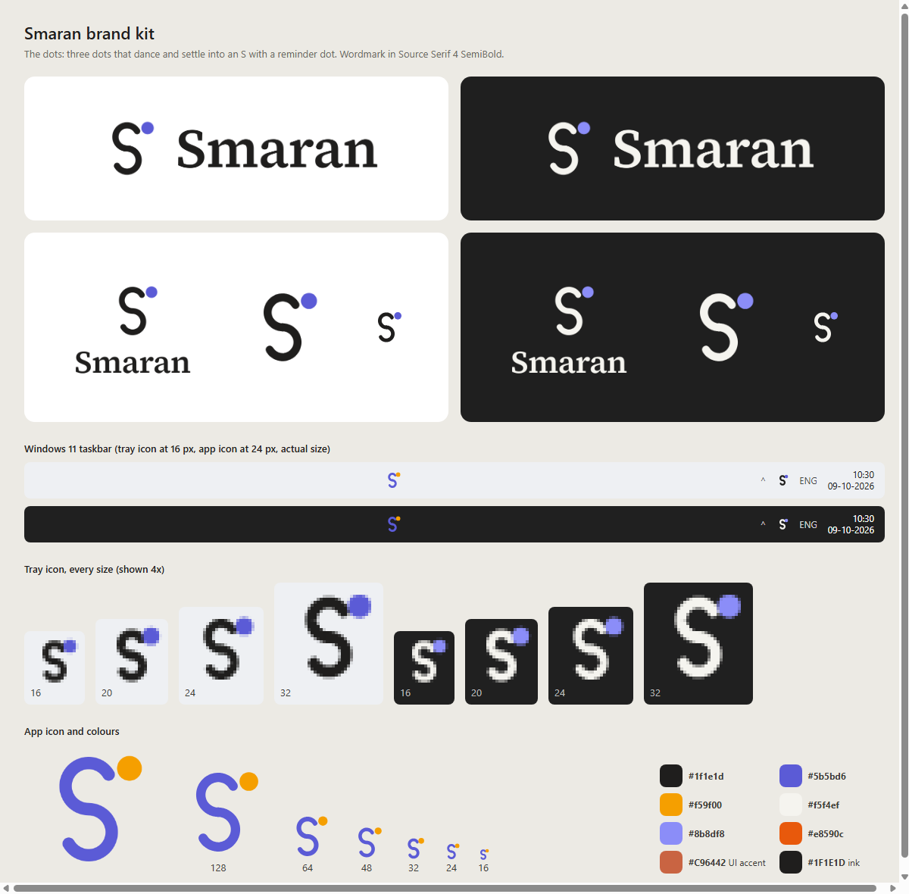

# Smaran brand kit

The mark is **the dots**: three dots that dance around each other and flow together into shapes
(a bell, a clock, a check…), then settle into an **S with a reminder dot**. The animation lives in
the app (`src/renderer/dots`, engine in `src/shared/dots`); this kit holds the still S.

## Colours

| Use | Light backgrounds | Dark backgrounds |
| --- | --- | --- |
| S line | `#1F1E1D` | `#F5F4EF` |
| Reminder dot | `#5B5BD6` | `#8B8DF8` |
| Third dot (dances) | `#F59F00` | `#FCC419` |
| Bell ringing | `#E8590C` | `#FF922B` |
| Done | `#2F9E44` | `#51CF66` |

The app icon (the .exe and installer) can't follow the theme, so it uses an indigo S (`#5B5BD6`)
with an amber dot (`#F59F00`), which reads on light and dark taskbars alike. The app's own UI accent
stays `#C96442`.

## In the tray and on the taskbar

Smaran animates its notification-area icon frame by frame (`Tray.setImage`, which uses
`Shell_NotifyIcon`) and its taskbar button (`BrowserWindow.setIcon`). It only animates while
something is happening, and draws the S dark on a light taskbar and light on a dark one:

| When | The dots show |
| --- | --- |
| Smaran starts | the dots form the S |
| A reminder is on screen | a ringing bell |
| You press Done | a check, then back to the S |
| You snooze | an hourglass, then back to the S |
| Reminders are paused, or it's quiet hours | a moon with a "z" |
| A reminder is due within a minute | a clock with turning hands |
| Nothing going on | the still S; now and then (and when you rest the pointer on it) a short dance |

## Files

| Folder | What |
| --- | --- |
| `svg/` | Editable sources: `symbol-light/dark`, `symbol-adaptive` (switches with `prefers-color-scheme`), horizontal and stacked lockups (light, dark, adaptive), `app-icon.svg` and the small app-icon sizes |
| `logo/` | PNG exports: the symbol at 64–512 px, and the lockups, light and dark |
| `tray/` | Still tray icons, used until the animation starts: `tray-light.ico` (dark S, for a light taskbar) and `tray-dark.ico` (light S, for a dark taskbar), each with 16, 20, 24, 32 and 48 px. `png/` and `svg/` hold every size, including 40 px |
| `app-icon/` | `app-icon.ico` (16 to 256 px), `app-icon-1024.png` and the PNG sizes |
| `previews/` | The preview sheet |
| `generator/` | The scripts that draw everything (see the top of `build.mjs`) |

Small sizes zoom in slightly and draw thicker lines (1.6x at 16–20 px, 1.35x up to 32 px), the same as the live tray animation, so the S stays legible.

## Wordmark

"Smaran" is set in **Source Serif 4 SemiBold** (free, SIL Open Font License), which Smaran already
bundles. The lockup SVGs embed the font, so they render the same everywhere. To edit them in a
design tool, install Source Serif 4 from Google Fonts.

## Clear space and minimum size

- **Clear space:** keep the reminder dot's width clear on every side.
- **Minimum size:** the S at 16 px; the horizontal lockup at 120 px wide; the stacked lockup at
  72 px wide.
- Keep the dot top right and in its own colour. Don't recolour the S in the dot's colour, and don't
  put the mark on a busy photo.
